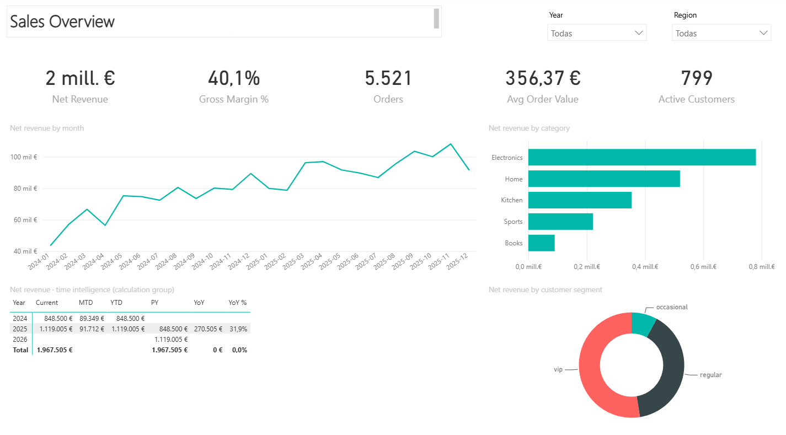
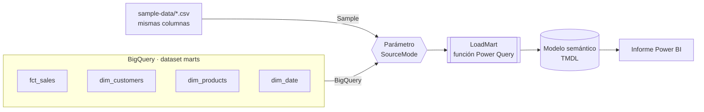
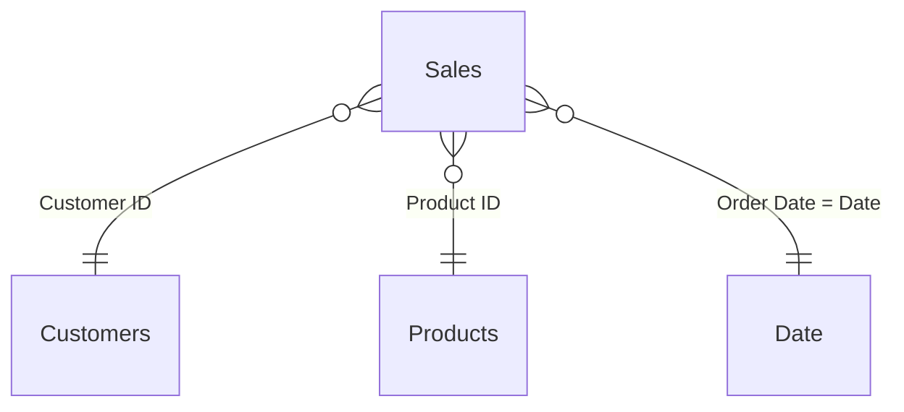

# Power BI Semantic Model · PBIP / TMDL

[](https://github.com/adonaismarrero/powerbi-sales-semantic-model/actions/workflows/ci.yml)


Modelo semántico de **Power BI** en formato de proyecto (**PBIP / TMDL**): todo el modelo es
texto versionado en Git, revisable en *pull requests* y validado automáticamente en CI.

Es la capa de consumo del pipeline
[**gcp-dataform-terraform-pipeline**](https://github.com/adonaismarrero/gcp-dataform-terraform-pipeline):
lee el modelo en estrella que Dataform construye en BigQuery. Con un parámetro puede leer también
unos **CSV de ejemplo** incluidos en el repositorio, así que se abre y funciona **sin necesidad de GCP**.

> **English summary** — Power BI semantic model stored as a PBIP/TMDL project: star schema
> (Sales, Customers, Products, Date), 17 DAX measures in display folders, a time-intelligence
> calculation group (MTD, YTD, PY, YoY, YoY %), dynamic row-level security and a parameterised
> source (BigQuery or bundled sample CSVs). CI loads the TMDL with the Tabular Object Model,
> checks every DAX reference and enforces modelling rules.



---

## Arquitectura



## Modelo



| Tabla | Tipo | Contenido |
|---|---|---|
| **Sales** | Hechos | Una fila por línea de pedido. Columnas numéricas ocultas: se consumen con medidas |
| **Customers** | Dimensión | Cliente, ciudad, región, segmento (ordenado), fecha del primer pedido |
| **Products** | Dimensión | Producto, categoría, precio, margen unitario, banda de precio (ordenada) |
| **Date** | Dimensión | Calendario marcado como tabla de fechas, jerarquía Año › Trimestre › Mes › Día |
| **_Measures** | Medidas | 17 medidas DAX en 4 carpetas |
| **Time Intelligence** | Grupo de cálculo | Current · MTD · YTD · PY · YoY · YoY % aplicables a cualquier medida |
| **Security** | Oculta | Usuario → regiones, para la seguridad a nivel de fila |

### Medidas

| Carpeta | Medidas |
|---|---|
| 1. Sales | Net Revenue · Gross Revenue · Discounts · Discount % · Units · Orders · Avg Order Value |
| 2. Profitability | Gross Margin · Gross Margin % |
| 3. Customers | Active Customers · New Customers · Revenue per Customer |
| 4. Order quality | All Orders · Cancelled Orders · Returned Orders · Cancellation Rate · Return Rate |

Las medidas de ventas solo cuentan pedidos entregados o enviados (`KEEPFILTERS` sobre
`Is Revenue`), de modo que un filtro del usuario por estado sigue funcionando.
*New Customers* usa `TREATAS` para aplicar el periodo seleccionado a la fecha del primer pedido
sin crear una relación adicional.

### Inteligencia de tiempo

Un único **grupo de cálculo** sustituye a decenas de medidas duplicadas (`Net Revenue YTD`,
`Orders PY`…): basta con poner *Time Calculation* en columnas o en un segmentador. *YoY %*
fuerza su propio formato de porcentaje.

### Seguridad a nivel de fila (RLS)

El rol **Regional Manager** filtra `Customers` (y por la relación, `Sales`) con
`USERPRINCIPALNAME()` contra la tabla `Security`. Se puede probar en Power BI Desktop con
*Modelado › Ver como › Regional Manager* y el usuario `manager.madrid@example.com`.

## Origen de datos

| Parámetro | Valor por defecto | Uso |
|---|---|---|
| `SourceMode` | `Sample` | `Sample` = CSV de ejemplo · `BigQuery` = dataset de marts |
| `SampleDataPath` | URL de `sample-data/` en este repo | También admite una carpeta local (terminada en `\`) |
| `BigQueryProject` | `my-company-data-prod` | Proyecto de GCP (y de facturación) |
| `BigQueryDataset` | `marts` | Dataset construido por Dataform |

Toda la carga pasa por la función **`LoadMart`**: las cuatro tablas usan la misma lógica, el
mismo tipado (`en-US`, independiente de la configuración regional del equipo) y cambian de
origen con un solo parámetro. En modo `Sample`, `Web.Contents` usa `RelativePath` (URL base
estática), de modo que el modelo también se puede actualizar en el servicio de Power BI.

## Validación (CI)

`tools/ModelValidator` carga el TMDL con el **Tabular Object Model** de Microsoft (la misma
librería que usa Power BI) y comprueba:

- que el modelo se deserializa sin errores (sintaxis, relaciones, columnas de ordenación…);
- que **cada referencia DAX** (`'Tabla'[Columna]`, `[Medida]`) existe en medidas, columnas
  calculadas, grupo de cálculo y filtros RLS;
- reglas de modelado: formato y carpeta en todas las medidas, claves ajenas ocultas, mismos
  tipos de datos en las relaciones, una única tabla de fechas marcada.

Además, el CI regenera `sample-data/` desde el repositorio del pipeline y verifica que el
resultado es idéntico.

```bash
dotnet run --project tools/ModelValidator -- SalesAnalytics.SemanticModel/definition
python scripts/build_sample_marts.py
```

## Cómo abrirlo

1. Power BI Desktop (con *Power BI Project* habilitado) › **Abrir** › `SalesAnalytics.pbip`.
2. **Actualizar**: en modo `Sample` descarga los CSV de este repositorio (acceso anónimo).
3. Para BigQuery: *Transformar datos › Editar parámetros* › `SourceMode = BigQuery` e indicar el proyecto.

## Estructura

```
.
├── SalesAnalytics.pbip
├── SalesAnalytics.SemanticModel/
│   └── definition/
│       ├── model.tmdl  database.tmdl  expressions.tmdl  relationships.tmdl
│       ├── tables/     # Sales, Customers, Products, Date, _Measures, Time Intelligence, Security
│       └── roles/      # Regional Manager (RLS)
├── SalesAnalytics.Report/
├── sample-data/        # marts de ejemplo (CSV)
├── scripts/build_sample_marts.py
└── tools/ModelValidator/   # validación del modelo con TOM (.NET)
```

## Licencia

[MIT](LICENSE) © Adonais Marrero
